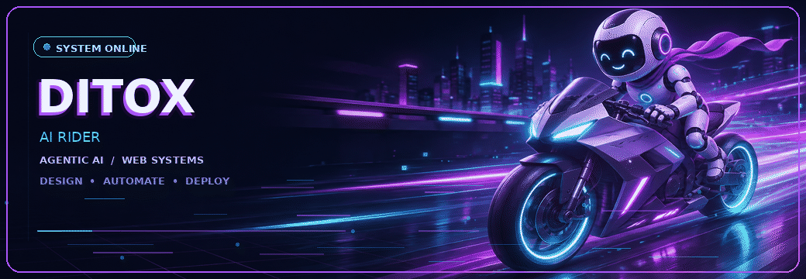
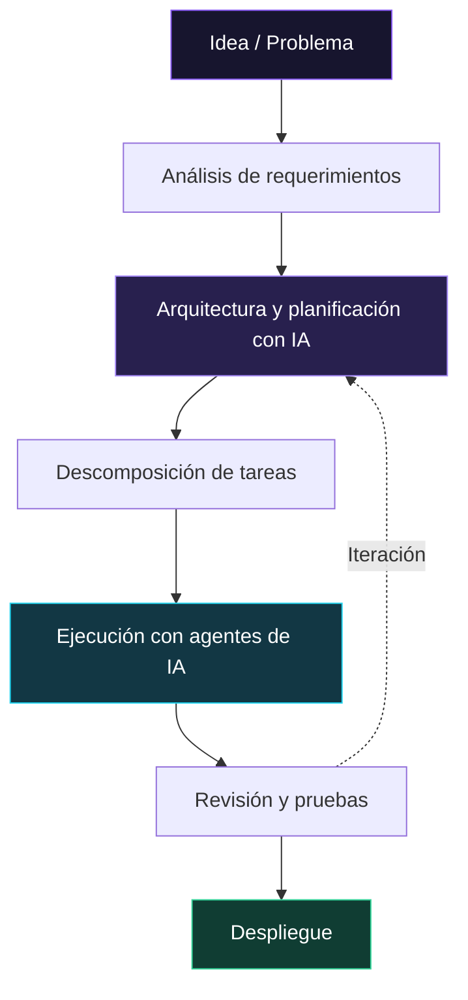

  

  <h1>GERARDO CANALES alias DITOX</h1>

  <h3>AI-Assisted Developer · Web Systems · Automation</h3>

  

  

    
    
    
  

  <i>"Si puedes imaginarlo, puedes programarlo."</i>

---

## ◆ About Me

Soy **Gerardo Canales**, conocido como **DITOX**, estudiante de Ingeniería de Sistemas e Informática en la Universidad Continental, Arequipa.

Me enfoco en convertir ideas en **productos digitales funcionales**, combinando desarrollo web, automatización, arquitectura de sistemas y herramientas de inteligencia artificial.

No me limito a escribir código: participo en el diseño de interfaces, definición de requerimientos, planificación de flujos, integración de servicios y despliegue de aplicaciones.

> **Mi enfoque:** construir soluciones útiles, escalables y preparadas para escenarios reales.

---

## ◆ Featured Projects

<table>
<tr>
<td width="50%" valign="top">

### 01 · IndicAlerts

**Trading Dashboard & Telegram Automation**

Plataforma modular para la gestión y seguimiento del mercado de criptomonedas, diseñada para operar continuamente.

**Características**

- Dashboard de control y gestión.
- Bot de Telegram con alertas automatizadas.
- Indicadores y condiciones personalizadas.
- Análisis de canales de YouTube con IA.
- Broadcast y administración de usuarios.
- Persistencia de datos y servicios en la nube.

**Ecosistema**

`Telegram Bot` `NoSQL` `Northflank` `AI` `Automation`

<a href="https://indicdtx--indicalerts-ditox-v1--tcggpbtpgkpk.code.run/">Live Web</a>

</td>
<td width="50%" valign="top">

### 02 · RapiCosturas

**Enterprise Micro App / PWA**

Aplicación web implementada para **RapiCosturas E.I.R.L.**, orientada a digitalizar procesos operativos entre sedes.

**Características**

- Registro y recepción de envíos.
- Gestión de operaciones entre sedes.
- Interfaz responsive para dispositivos móviles.
- Almacenamiento multimedia en la nube.
- Administración de metadatos mediante MongoDB.
- Despliegue web mediante Netlify.

**Ecosistema**

`PWA` `MongoDB` `Netlify` `Cloudflare` `Web App`

<a href="https://rapicosturas.netlify.app/envios?tab=recepcion&site=yanahuara">Live Web</a>

</td>
</tr>
</table>

---

## ◆ AI Engineering & Agentic Workflows

La inteligencia artificial forma parte de mi proceso de desarrollo, desde la planificación hasta la implementación y revisión técnica.

### AI Ecosystem

 

### My AI Development Workflow

### Agentic Development Practices

**Context Engineering**  
Organización de contexto, instrucciones y documentación para mejorar la precisión del trabajo con agentes.

**Skills & Structured Workflows**  
Uso de archivos Markdown, skills, planes de ejecución y separación de responsabilidades.

**Multi-model Strategy**  
Selección de modelos según complejidad: razonamiento y planificación para decisiones difíciles; modelos ligeros para tareas acotadas.

**Token & Memory Optimization**  
Estructuración de información y árboles de memoria para mantener continuidad y optimizar recursos en proyectos extensos.

---

## ◆ Technology Ecosystem

### Web & Application Architecture

### Cloud, Databases & Infrastructure

### Programming Languages

---

### ◆ Build Beyond Code

**Systems · Automation · AI · Products**

Me interesa desarrollar sistemas que resuelvan problemas reales, integrando diseño, lógica, automatización e inteligencia artificial.

  

Designed by DITOX · Arequipa, Perú

